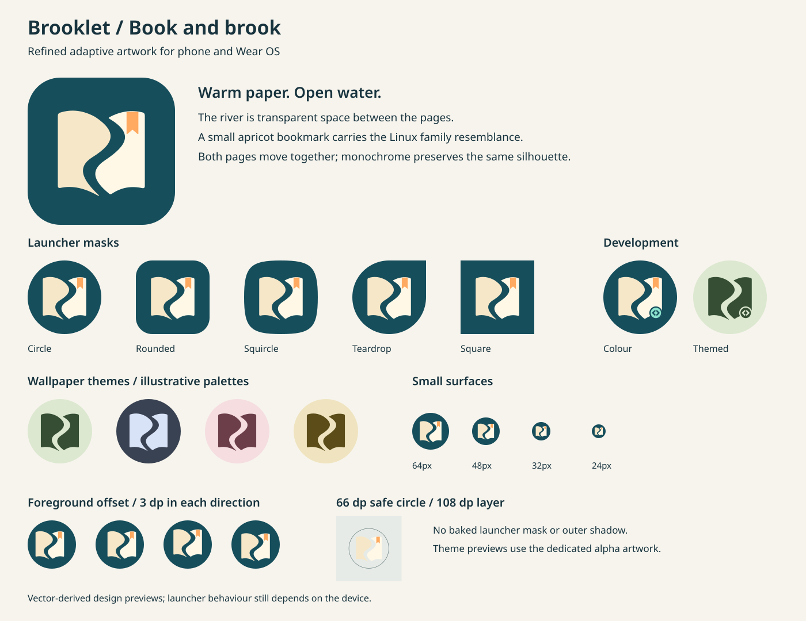

# Book and brook

Brooklet's Android identity uses two open paper surfaces as the banks of a
winding brook. It develops concept A from
[the original studies](../android-icon-exploration/README.md).



## Design decisions

- The pages share one foreground layer. Their transparent river stays intact
  when a launcher moves the foreground relative to the background.
- The foreground and development badge have an additional 15% inset about
  (54, 54), giving the paper corners more clearance inside circular phone and
  Wear launcher masks. The background remains full bleed.
- The outer paper corners and bookmark notch have small rounded joins. Broad
  curves and generous separation keep the river readable at small sizes.
- Deep teal (`#164E5C`), warm paper (`#F6E7C8` and `#FFF8E7`), and an apricot
  bookmark (`#FFAA60`) retain the Linux icon's book, brook, and bookmark family
  resemblance with flatter geometry suited to Android.
- The monochrome artwork uses exactly the two paper paths. The bookmark is a
  colour accent; the silhouette and river identify the app under any tint.
- Artwork uses 108 × 108 dp layers. The complete foreground, including the
  development badge, fits the centred 66 dp diameter safe circle. The full-bleed
  background has no baked outer shape or shadow.
- A mint code badge distinguishes debug builds on both phone and Wear. In the
  themed version, transparent brackets and a transparent moat preserve that
  distinction without depending on colour. Its centre is (69.3, 69.3), with a
  6.375 dp outer radius: less than 29 dp from the layer centre at its farthest
  point.

## Editing and generation

Edit these original, path-only SVG masters:

- `foreground.svg`: the two named page paths and bookmark.
- `background.svg`: the full-bleed teal plane.
- `dev-badge.svg`: the moat, disc, and code brackets.

Run from the repository root with Python 3 and ImageMagick 7 (SVG and WebP
support; Noto Sans for the labelled preview):

```sh
python3 scripts/generate_launcher_icons.py
python3 scripts/generate_launcher_icons.py --check
```

The generator deliberately accepts only plain filled paths, so unsupported SVG
features fail instead of silently disappearing during Android conversion.
The monochrome SVGs, Android XML, bitmap compatibility exports, Play asset,
and preview are generated outputs. Do not edit them independently.

The generator updates main and debug resources in both `app` and `app-wear`.
Both launcher names resolve to adaptive XML. Their foreground, background, and
monochrome layers remain independent resources; the bitmap exports do not
replace the adaptive icon. Phone compatibility bitmaps are regenerated at all
five existing densities to avoid retaining the old droplet in the resource
tree. Both minimum Android versions support adaptive icons.

`play-icon.png` is a separate, opaque 512 × 512 full-square, 32-bit PNG. Play
supplies its own corners and outer shadow. It is prepared artwork, not a
published store change.

## System surfaces and review

The manifest application icon supplies launcher, Settings, overview, and share
surfaces. Android 12 and later also use it for the default system splash;
there is no separate splash animation or added startup delay. The Wear Tile
preview represents the inbox rather than the application logo and remains a
separate asset. Neither app currently posts notifications, so this change does
not add a notification status icon.

The preview shows example masks, four illustrative theme palettes, development
treatments, small sizes, and foreground offsets. These are design renders,
not device screenshots. Actual masks, theme colours, icon scaling, and motion
are selected by the Android device and launcher. Before release, review the
installed icon on a physical phone and watch as well as in emulator checks.

## Original implementation checks (2026-10-20, before the additional inset)

- Phone and Wear debug APKs built successfully; release resources compiled.
- Debug and release lint passed with no issues in both applications.
- `generate_launcher_icons.py --check` confirmed all 35 generated assets.
- High-resolution alpha renders placed the paper silhouette within a 32.82 dp
  radius and the development badge within a 32.89 dp radius, inside the 33 dp
  safe radius. The paper occupies approximately 50 × 48.3 dp.
- Phone and Wear XML matched byte for byte. AAPT inspection confirmed the
  final page and monochrome path data in both packaged debug APKs.
- The SVG-derived preview was visually reviewed for masks, themed palettes,
  development badges, and small sizes. The Play PNG was confirmed to be opaque,
  sRGB, 512 × 512 pixels with four 8-bit channels.
- Live launcher, Settings, splash, and watch appearance remain unverified.
  The existing API 37.1 emulator and a clean API 36 emulator both crashed in
  the host emulator process before app installation; no physical device was
  connected. Those failures did not exercise the application or its icon.

## First launcher clearance adjustment (2026-10-25, 90% version)

The foreground and development badge were scaled to 90% around the layer centre,
then all 35 outputs were regenerated. In high-resolution alpha renders the paper
reaches a 29.55 dp radius and the badge reaches 29.63 dp, leaving at least 3.37 dp
inside the central 33 dp safe radius. Phone and Wear main/debug launcher XML
matches byte for byte. Both debug APKs, both release resource sets and debug lint
passed; the generator's `--check` also passed. Android's native adaptive-icon
renderer was visually checked on the Wear emulator for colour, development,
monochrome and monochrome-development icons. A phone launcher was not inspected.

## Further launcher clearance (85% version)

The paper and development badge are now 85% of their original size, a further
5.6% reduction from the first inset. High-resolution alpha renders give a
27.92 dp paper radius and 28.00 dp badge radius, leaving at least 5 dp inside
the adaptive safe circle. The background remains full bleed, and all normal,
themed and development resources are regenerated together for phone and Wear.

References:

- [Adaptive icons](https://developer.android.com/develop/ui/compose/system/icon_design_adaptive)
- [System splash screens](https://developer.android.com/develop/ui/views/launch/splash-screen)
- [Google Play icon assets](https://developer.android.com/distribute/google-play/resources/icon-design-specifications)
